 

---

### 👋 Somos ING Asesoría Empresarial

Firma privada e independiente de **Santo Domingo, Ecuador**, especializada en auditoría financiera NIIF, consultoría empresarial, tercerización contable y de nómina, e impuestos y práctica legal.

Además de asesorar empresas, **construimos nuestra propia tecnología**: el sistema INGAE automatiza el trabajo contable y tributario de la firma para que cada cifra cuadre al centavo.

 

### 🏛️ Nuestras divisiones

<table>
  <tr>
    <td width="50%" valign="top">
      <b>📊 Auditoría y Aseguramiento</b> 
      Revisión independiente de estados financieros bajo NIIF y aseguramiento normativo.
    </td>
    <td width="50%" valign="top">
      <b>🧭 Consultoría Estratégica y de Negocios</b> 
      Consultoría gerencial, gestión de riesgos y avalúos.
    </td>
  </tr>
  <tr>
    <td width="50%" valign="top">
      <b>💼 Servicios Empresariales y Tercerización</b> 
      Contabilidad integral, nómina y gestión patronal.
    </td>
    <td width="50%" valign="top">
      <b>⚖️ Impuestos y Práctica Legal</b> 
      Planificación tributaria, precios de transferencia, gobierno corporativo y societario.
    </td>
  </tr>
</table>

 

### 🛠️ Lo que construimos

| Proyecto | Qué hace |
|---|---|
| **Sistema INGAE** | Portal interno de automatización contable: comprobantes electrónicos del SRI, cruce de compras, ventas y retenciones contra el sistema de cada cliente, control de obligaciones, nómina y rol laboral, y archivos compartidos del equipo. |
| **Extensión SRI** | Extensión de Chrome que trae los comprobantes del portal del SRI directo al sistema. |
| **[ingae.org](https://www.ingae.org)** | Sitio institucional bilingüe de la firma. |

🔒 Los repositorios son privados: contienen información de nuestros clientes.

 

### ⚙️ Tecnologías

  
  
  
  
  
  
  
    

 

### 👥 Equipo

<table>
  <tr>
    <td align="center" width="200">
      <a href="https://github.com/DESC05">
         
        <b>Ing. Dereck Castro</b>
      </a> 
      Jefe de equipo · Desarrollo 
      <a href="https://github.com/DESC05">@DESC05</a>
    </td>
    <td align="center" width="200">
       
      <b>Ing. Anderson Plua</b> 
      Equipo de desarrollo
    </td>
  </tr>
</table>

---

  ING Asesoría Empresarial · Santo Domingo, Ecuador · Cumplimiento LOPDP y secreto profesional

